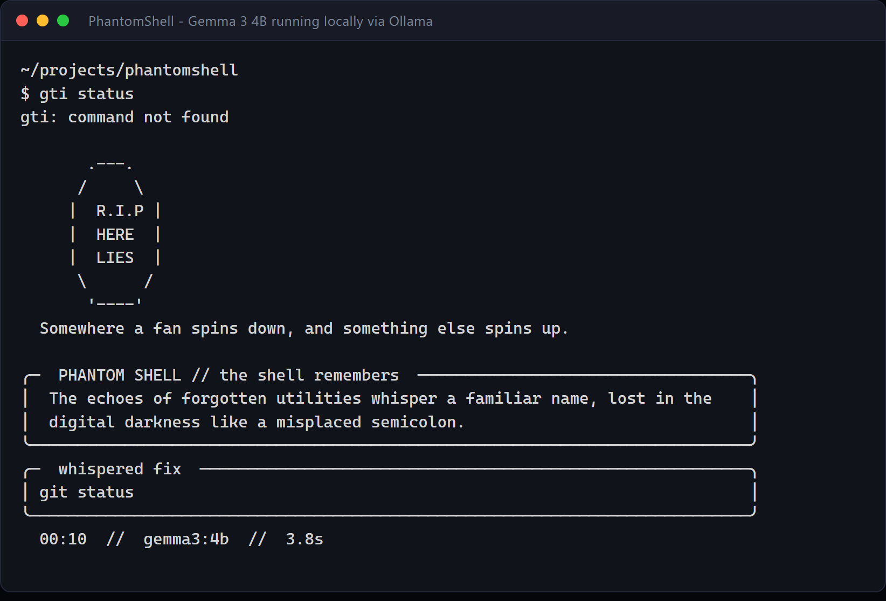
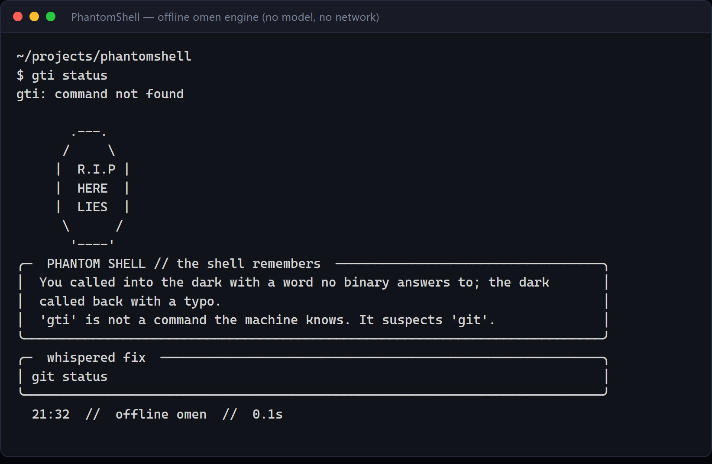

# PhantomShell: The Haunted Terminal

> An offline-first CLI ghost that haunts your shell when a command fails.
> One eerie sentence, one exact fix — from your machine, or from a cloud API.

PhantomShell watches your prompt. When a command exits non-zero, a digital ghost
stirs: ASCII apparition, a dim green whisper about your mistakes, and a clean,
copy-pasteable command that fixes the error. By default everything runs locally
through [Ollama](https://ollama.com) — no API keys, no telemetry, no network.
Flip one environment variable and the same ghost can consult Groq, OpenAI,
OpenRouter, Gemini, DeepSeek or any OpenAI-compatible endpoint.

Built for the **Ghost in the Machine** hackathon — the
[Hacktoberfest Open-Source AI Challenge, Week 4](https://dev.to/challenges/hf26).
Designed to survive a demo with the Wi-Fi off — the omen engine needs no model at all.



*Live run: `gemma3:4b` on an AMD laptop with no GPU, served locally by Ollama.
The whisper above was written by the model; the fix below it was not.*

```
       .-.
      (o o)
      | O \
      |   |
      |   |
      ^^^^^
  Somewhere a fan spins down, and something else spins up.

┌─  PHANTOM SHELL // the shell remembers  ────────────────────────────────────┐
│  You called into the dark with a word no binary answers to; the dark        │
│  called back with a typo.                                                   │
│  'gti' is not a command the machine knows. It suspects 'git'.               │
└─────────────────────────────────────────────────────────────────────────────┘
┌─  whispered fix  ───────────────────────────────────────────────────────────┐
│ git status                                                                  │
└─────────────────────────────────────────────────────────────────────────────┘
  23:58  //  qwen2.5-coder:1.5b  //  0.4s
```

---

## Why it is not just a wrapper around a chatbot

| | |
|---|---|
| **Local by default** | Default backend is `127.0.0.1:11434`. Proxies are explicitly bypassed so a local daemon never leaks through `HTTP_PROXY`. |
| **Cloud optional** | `--provider groq` (or `openai`, `openrouter`, `gemini`, `deepseek`, `custom`) uses one OpenAI-compatible adapter. Keys are read from env vars only, never stored or printed. |
| **Small models** | Locally, auto-detects `qwen2.5-coder:1.5b`, `gemma3:4b` or `llama3.2:1b`, keeps them warm for 30 minutes. Fast on CPU. |
| **Never executes anything** | It prints a suggested command. You decide whether to run it. |
| **Never breaks your shell** | Always exits `0`, bounded timeout, no tracebacks, restores your exit code, skips `Ctrl+C`, one haunt per history entry. |
| **Degrades in character** | If the model is asleep (or the API key is wrong), a deterministic "omen engine" still fixes typos, missing Python modules, permissions, busy ports and bad paths. |
| **Night mode (opt-in)** | After midnight, the ghost may murmur a single dim line after a *successful* command. No model call, no interruption. |
| **Terminal-injection aware** | Strips ANSI/OSC escapes and bidi controls from error text, redacts common credential shapes, and truncates before anything is printed or sent to the model. |

---

## Quickstart (2 minutes)

**1. Install Ollama and one small model**

```bash
# macOS / Linux / Windows: https://ollama.com/download
ollama pull qwen2.5-coder:1.5b     # best at shell syntax (recommended)
ollama pull gemma3:4b              # Google's open-weight model, best prose
# or: ollama pull llama3.2:1b      # chattier, slightly better prose
```

> **Gemma 3** works out of the box — it is an open-weight model with a permissive
> licence, and it is what the demo screenshots in `docs/` were generated with:
> `python haunt.py "gti status" "gti: command not found" --model gemma3:4b`.
> Any Ollama model works; `--model` takes whatever you have pulled.

Ollama usually runs as a background service. If not:

```bash
ollama serve
```

**2. Install the package or dependencies**

```bash
cd PhantomShell
# Either install in editable mode (provides 'phantomshell' and 'haunt' commands):
python -m pip install -e .

# Or install dependencies only:
python -m pip install -r requirements.txt
```

**2b. (Optional) Borrow a bigger brain from the cloud**

Local models are charming but 1–1.5B params is small. Get a free key at
[console.groq.com/keys](https://console.groq.com/keys), then export it in the
same shell that runs the hook. Never paste the key into the repo.

```bash
export GROQ_API_KEY="gsk_..."        # bash / zsh
```

```powershell
$env:GROQ_API_KEY = "gsk_..."        # PowerShell (current session)
# or persist for the user: setx GROQ_API_KEY "gsk_..."
```

With `GROQ_API_KEY` present, `--provider auto` picks Groq automatically. Without
it, the same command quietly stays on Ollama. Force either side with
`--provider groq` / `--provider ollama`.

**3. Wake the ghost**

```bash
# Works even with Ollama stopped (pre-baked omen engine):
python haunt.py --demo --offline

# Live, local model:
python haunt.py "gti status" "gti: command not found"
python haunt.py "python app.py" "ModuleNotFoundError: No module named 'yaml'"
python haunt.py "npm run dev" "Error: listen EADDRINUSE: address already in use :::3000"

# Live, cloud model (needs GROQ_API_KEY):
python haunt.py "gti status" "gti: command not found" --provider groq
```

> First inference after a cold start can take 5–15 s on CPU while the model
> loads. Warm it once with `ollama run qwen2.5-coder:1.5b "hi"` before a demo,
> or raise the timeout (`--timeout 30`). After that, `keep_alive` keeps it hot.
> Cloud answers usually arrive in well under a second.

---

## Shell integration

The hooks live in [`shell/`](shell/). They are small, dependency-free, and
return your original exit status so your existing prompt/theme keeps working.

### Automatic hook installation (fastest)

PhantomShell can inspect your environment and safely install the hook into your shell's startup profile:

```bash
python haunt.py --install-hook         # auto-detects current shell
python haunt.py --install-hook zsh     # or explicitly: bash, zsh, powershell, fish
```

To see the exact line without modifying any file:

```bash
python haunt.py --show-hook
```

---

### a) Bash or Zsh

Add one line to `~/.bashrc` (bash) or `~/.zshrc` (zsh):

```bash
source "$HOME/PhantomShell/shell/phantom.bash"
```

Reload with `source ~/.bashrc` (or open a new terminal), then fail something:

```bash
gti status
```

Knobs (set before sourcing):

```bash
PHANTOM_HOME="$HOME/PhantomShell"     # auto-detected, usually unnecessary
PHANTOM_PYTHON=python3                # interpreter, auto-detected
PHANTOM_SKIP="0 130 141"              # exit codes to ignore (Ctrl+C, SIGPIPE)
PHANTOM_EXTRA_ARGS="--timeout 20"     # extra haunt.py flags
PHANTOM_OFF=1                         # mute the ghost for this session
```

If you prefer a minimal inline hook instead of the file:

```bash
# bash: ~/.bashrc
_phantom_haunt() {
    local code=$?
    [ "$code" -eq 0 ] && return 0
    local cmd
    cmd=$(HISTTIMEFORMAT= builtin history 1)
    cmd="${cmd#"${cmd%%[![:space:]]*}"}"   # trim leading spaces
    cmd="${cmd#"${cmd%%[!0-9]*}"}"         # drop history number
    cmd="${cmd#\*}"
    cmd="${cmd#"${cmd%%[![:space:]]*}"}"
    command python3 "$HOME/PhantomShell/haunt.py" "$cmd" "exit code $code"
    return "$code"
}
PROMPT_COMMAND="_phantom_haunt${PROMPT_COMMAND:+;$PROMPT_COMMAND}"
```

```zsh
# zsh: ~/.zshrc
_phantom_haunt() {
    local code=$?
    (( code == 0 )) && return 0
    command python3 "$HOME/PhantomShell/haunt.py" "$(fc -ln -1)" "exit code $code"
    return $code
}
precmd_functions+=(_phantom_haunt)
```

**Why the hook passes only the exit code by default:** a shell cannot read the
stderr of a process it already reaped. The ghost still gets the failed command
and the exit status, which handles the majority of cases. If you want real error
text, opt in before sourcing:

```bash
PHANTOM_CAPTURE_STDERR=1
```

That routes the shell's stderr through `tee` into a temp log for the prompt to
read. It is off by default because it touches every command's stderr.

### b) PowerShell (Windows PowerShell 5.1+ / PowerShell 7+)

Add one line to your profile — find it with `$PROFILE`, then:

```powershell
. "$HOME\PhantomShell\shell\phantom.ps1"
```

Reload with `. $PROFILE`, then:

```powershell
gti status
```

If scripts are blocked:

```powershell
Set-ExecutionPolicy -Scope CurrentUser RemoteSigned
```

Minimal inline version, if you prefer:

```powershell
$global:__PhantomPrompt = $function:prompt
function global:prompt {
    $ok = $?; $code = $LASTEXITCODE
    if (-not $ok) {
        $env:PHANTOM_LAST_COMMAND = (Get-History -Count 1).CommandLine
        $env:PHANTOM_LAST_ERROR = if ($Error[0]) { $Error[0].Exception.Message } else { "exit code $code" }
        python "$HOME\PhantomShell\haunt.py" 2>$null
    }
    $global:LASTEXITCODE = $code
    & $global:__PhantomPrompt
}
```

The bundled hook is more careful than the snippet above: it de-duplicates empty
prompts, skips `Ctrl+C`, reads `PHANTOM_EXTRA_ARGS` live, and passes evidence
through environment variables so quotes and Unicode survive Windows argument
parsing.

### c) Fish shell (>= 3.0)

Add one line to `~/.config/fish/config.fish`:

```fish
source "$HOME/PhantomShell/shell/phantom.fish"
```

Reload fish (`source ~/.config/fish/config.fish`), then test:

```fish
gti status
```

The fish hook connects to fish's native `fish_postexec` event, captures the exit code,
and preserves `$status` for your existing prompt theme.

### Choosing the backend from the hook

The hooks inherit your environment, so the simplest switch is the variable:

```bash
export GROQ_API_KEY="gsk_..."   # presence alone makes --provider auto choose Groq
```

Or pin it explicitly for one session (bash/zsh):

```bash
PHANTOM_EXTRA_ARGS="--provider groq --model openai/gpt-oss-20b"
```

```powershell
$env:PHANTOM_EXTRA_ARGS = "--provider groq --model openai/gpt-oss-20b"
```

The bundled PowerShell hook reads `PHANTOM_EXTRA_ARGS` live, so the change
applies to the next failed command without reloading the profile.

### Late-night murmurs (optional)

The ghost can also acknowledge *successful* commands between 00:00 and 05:00 —
one dim line, no model call, no ASCII art:

```bash
PHANTOM_NIGHT=1          # enable (default: off)
PHANTOM_NIGHT_CHANCE=15  # percent chance per command (default: 15)
```

```powershell
$env:PHANTOM_NIGHT = '1'
$env:PHANTOM_NIGHT_CHANCE = '15'
```

It is deliberately quiet and probabilistic: the terminal should feel watched,
not heckled. The clock check lives in `haunt.py --night-whisper`, which prints
nothing outside the witching hours.

---

## CLI reference

```
python haunt.py "<failed command>" "<error output or exit code>" [options]
```

| Flag | What it does |
|---|---|
| `--demo` | Use a built-in failing scenario. Great for recordings. |
| `--offline` | Never call a model; use the omen engine only. |
| `--install-hook [SHELL]` | Safely append the hook to your startup profile (`auto`, `bash`, `zsh`, `powershell`, `fish`). |
| `--show-hook [SHELL]` | Print the exact shell hook configuration line without modifying files. |
| `--provider NAME` | `auto` (default), `ollama`, `groq`, `openai`, `openrouter`, `gemini`, `deepseek`, `custom`. |
| `--api-base URL` | Override the cloud base URL (OpenAI-compatible). Also `PHANTOM_API_BASE`. |
| `--night-whisper` | Print one idle line if it is late (used by the hooks). |
| `--fix-only` | Print **only** the corrected command (for clipboard/pipes). |
| `--model NAME` | Model name, or `auto` (default) to pick an installed local model / the provider default. |
| `--host URL` | Ollama base URL (default `http://127.0.0.1:11434`). |
| `--timeout SEC` | How long to wait for the ghost (default `10`). |
| `--no-art` | Skip the ASCII apparition. |
| `--no-flicker` | Disable the shimmer animation. |
| `--no-color` | Disable colour (also honours `NO_COLOR`). |
| `--seed N` | Reproducible art/wording, for demos and screenshots. |
| `--version` | Print the version. |

Examples:

```bash
# Copy the fix to the clipboard instead of reading it
python haunt.py "gti status" "command not found" --offline --fix-only | clip      # Windows
python haunt.py "gti status" "command not found" --offline --fix-only | pbcopy    # macOS
python haunt.py "gti status" "command not found" --offline --fix-only | xclip    # Linux

# Record a deterministic demo
python haunt.py --demo --offline --seed 7
```

`--fix-only` is meant for **reading or copying**, not for `eval`. The ghost is a
very small model; treat its suggestions as advice, not authority.

---

## How it works

```
 command fails
      │
      ▼
 shell hook ── last command + exit code (+ stderr if opted in)
      │
      ▼
 haunt.py ── sanitize ANSI/OSC • redact secrets • truncate
      │
      ├── backend? ──local──► POST 127.0.0.1:11434/api/generate (tiny model)
      │            └─cloud──► POST {base}/chat/completions (Groq/OpenAI/…)
      │                                  │
      │                                  ▼
      │                             parse one-sentence whisper + fenced fix
      │
      └── no / timeout / 401 / 429 / bad JSON ──► deterministic omen engine
                                                   + pre-baked whisper
                                                      │
                                                      ▼
                                                rich render (art, panels, meta)
```

Fallback chain:

1. **Explicit model** or **auto-detected** installed Ollama model (`/api/tags`),
   or the provider's default cloud model.
2. Any backend failure — refused connection, timeout, missing model, rejected
   key, rate limit, empty response, malformed JSON — becomes a friendly reason
   plus the offline omen.
3. Anything unexpected is swallowed by `main()`; at worst you get one dim line,
   never a traceback in your prompt. Set `PHANTOM_DEBUG=1` while developing.

### The offline omen engine

Small and deliberately unglamorous, but it makes the demo work with the network
off:

- `gti status` → `git status` (fuzzy match against common commands)
- `No module named 'yaml'` → `python3 -m pip install pyyaml` (import→PyPI map)
- `Cannot find module 'express'` → `npm install express` (with pnpm/yarn detection)
- `Permission denied` → `sudo …`, with special cases for Docker and SSH keys
- `EADDRINUSE :::3000` → `lsof -i :3000`
- `branch … has no upstream branch` → `git push --set-upstream origin <branch>`
- `Cannot connect to Docker daemon` → `sudo systemctl start docker` (or Docker Desktop)
- `error[E0432]: unresolved import 'serde'` → `cargo add serde` (Rust)
- `Cannot find path …` / `No such file or directory` → list the parent directory
- `exit code 130` → "The spell was interrupted", no invented fix
- anything else → an honest "the bones are silent", no hallucinated command

The same failure with Ollama stopped and the network unplugged — no model, no
network, still in character:



---

## Configuration

| Variable | Default | Purpose |
|---|---|---|
| `PHANTOM_PROVIDER` | `auto` | `auto`, `ollama`, `groq`, `openai`, `openrouter`, `gemini`, `deepseek`, `custom`. `auto` uses Groq only when `GROQ_API_KEY` is set. |
| `GROQ_API_KEY` | unset | Groq key; also the signal `auto` looks for. |
| `PHANTOM_API_KEY` | unset | Generic key for any cloud provider (fallback if the provider-specific var is missing). |
| `PHANTOM_API_BASE` | provider default | Override the OpenAI-compatible base URL (e.g. LM Studio at `http://127.0.0.1:1234/v1`). |
| `OPENAI_API_KEY` / `OPENROUTER_API_KEY` / `GEMINI_API_KEY` / `DEEPSEEK_API_KEY` | unset | Provider-specific keys. |
| `PHANTOM_MODEL` | `auto` | Model name; `auto` means Ollama auto-detect or the provider default. |
| `PHANTOM_OLLAMA_URL` | `http://127.0.0.1:11434` | Ollama base URL. |
| `PHANTOM_TIMEOUT` | `10` | Seconds to wait; also `--timeout`. |
| `PHANTOM_KEEP_ALIVE` | `30m` | How long Ollama keeps the model loaded. |
| `PHANTOM_SEED` | unset | Reproducible art/wording. |
| `PHANTOM_SHELL` | auto | Shell name used in the prompt (`bash`, `zsh`, `powershell`). |
| `PHANTOM_OFF` | `0` | `1` mutes the hook. |
| `PHANTOM_SKIP` | `0 130 141` | Exit codes the bash/zsh hook ignores. |
| `PHANTOM_EXTRA_ARGS` | empty | Extra flags for the hook to pass. |
| `PHANTOM_CAPTURE_STDERR` | `0` | `1` enables stderr capture in bash/zsh. |
| `PHANTOM_NIGHT` | `0` | `1` enables late-night murmurs after success. |
| `PHANTOM_NIGHT_CHANCE` | `15` | Percentage chance per successful command. |
| `PHANTOM_DEBUG` | `0` | `1` shows tracebacks instead of the shroud message. |
| `NO_COLOR` | unset | Standard colour opt-out, honoured by `rich`. |

Provider defaults (override base URL and model with the variables above):

| Provider | Base URL | Default model |
|---|---|---|
| `groq` | `https://api.groq.com/openai/v1` | `openai/gpt-oss-20b` |
| `openai` | `https://api.openai.com/v1` | `gpt-4o-mini` |
| `openrouter` | `https://openrouter.ai/api/v1` | `meta-llama/llama-3.3-70b-instruct` |
| `gemini` | `https://generativelanguage.googleapis.com/v1beta/openai` | `gemini-2.5-flash` |
| `deepseek` | `https://api.deepseek.com/v1` | `deepseek-chat` |
| `custom` | you supply `PHANTOM_API_BASE` | you supply `PHANTOM_MODEL` |

`custom` is for LM Studio, vLLM, LiteLLM and anything else that speaks the same
dialect; it may run without a key:

```bash
PHANTOM_PROVIDER=custom \
PHANTOM_API_BASE=http://127.0.0.1:1234/v1 \
PHANTOM_MODEL=local-model \
python haunt.py "gti status" "command not found"
```

---

## Safety and privacy

- **Local by default.** With `--provider ollama` (or `auto` and no key) requests
  go only to the configured Ollama host. That client explicitly disables proxies,
  so `HTTP_PROXY` cannot redirect a localhost call.
- **Cloud sends your error text.** When you opt into a cloud provider, the failed
  command, error output, shell name and working directory are sent to that
  provider's API. Sanitising and redaction happen first, but the vendor still
  sees what is left. Use `--offline` or Ollama if the error may contain secrets.
- **Keys stay in the environment.** API keys are read from variables, sent only
  in the `Authorization` header, and scrubbed from error messages (a 401 body
  that echoes the key cannot leak it to your prompt). Nothing is written to disk.
- **No execution.** Nothing the model writes is ever run. There is no `eval`,
  no `subprocess`, no shell interpolation of model output.
- **Sanitised input and output.** CSI/OSC escape sequences, C0/C1 controls and
  bidi overrides are stripped; the text is tail-truncated (compilers put the
  useful part last) before printing or sending.
- **Secret redaction.** Bearer tokens, `sk-…`, `gsk_…`, `ghp_…`, AWS access key
  IDs and `password=…`-style pairs are masked before the prompt leaves the
  process. This is best-effort, not a guarantee — review what your errors contain.
- **Injection aware.** Command and error text are wrapped in `<command>` /
  `<error>` tags, and the system prompt tells the model to treat them as
  evidence, never instructions.
- **Shell friendly.** Exit status `0` always, bounded timeout, errors contained.
  The reading shell's `$?` / `$LASTEXITCODE` is restored afterwards.

---

## Troubleshooting

| Symptom | Fix |
|---|---|
| `No ghost answers at http://127.0.0.1:11434` | Start Ollama: `ollama serve` (or launch the desktop app). |
| `the model '…' is not installed` | `ollama pull gemma3:4b` (or `qwen2.5-coder:1.5b`, `llama3.2:1b`). |
| `groq rejected the API key (HTTP 401)` | The key is wrong, expired, or has no access to that model. Re-create it at [console.groq.com/keys](https://console.groq.com/keys) and export it in this shell (`echo $env:GROQ_API_KEY` / `echo $GROQ_API_KEY`). |
| `no API key for groq; set GROQ_API_KEY or PHANTOM_API_KEY` | Export the key, or pass `--provider ollama` / `--offline`. Keys are never read from a config file. |
| `groq is rate-limiting the seance (HTTP 429)` | Free-tier limit hit. Wait a moment, use `--model openai/gpt-oss-120b` for a different bucket, or let it fall back to Ollama. |
| `model '…' was not found on …` | Wrong model id for that provider. Set `PHANTOM_MODEL` to one your key can use, e.g. `openai/gpt-oss-20b` or `llama-3.3-70b-versatile` on Groq. |
| Cloud answers but the hook still uses Ollama | The key is not in the environment the shell hook inherits. Export it in the same session, or set `PHANTOM_EXTRA_ARGS="--provider groq"`. |
| First answer takes 10+ s | Cold model load. Warm it: `ollama run gemma3:4b "hi"`, or `--timeout 30`. |
| Ghost never appears | Check the hook is sourced (`echo $PROMPT_COMMAND` / `$PROFILE`), your command really failed, and the code is not in `PHANTOM_SKIP`. |
| Ghost appears twice | Both the file hook and an inline snippet are active. Keep one. |
| Garbled art / boxes | Use Windows Terminal, or run with `--no-art`. |
| PowerShell profile ignored | `Set-ExecutionPolicy -Scope CurrentUser RemoteSigned`, then `. $PROFILE`. |
| Colours look wrong | `--no-color`, or set `NO_COLOR=1`. |
| Shell hangs on failure | Lower `--timeout`; make sure the host is local (`127.0.0.1`, not a LAN IP). |

---

## Tests

No Ollama, no network, no TTY required — fake Ollama and fake OpenAI-compatible
daemons are part of the suite:

```bash
python -m unittest discover -s tests -v
# or with pytest:
pytest -v
```

73 tests cover escape-sequence stripping, secret redaction, truncation, reply
parsing, every offline omen rule (typos, modules, packages, permissions, ports,
git upstream, daemons, rust crates), the Ollama client (success, 404 model, refused
connection), provider resolution (`auto` vs explicit, key precedence, custom
endpoints), the cloud client (success, 401/429/404, key never leaked, content
parts), prompt construction, night whispers, hook installers, and CLI paths.

---

## Project layout

```
PhantomShell/
├── .github/
│   └── workflows/
│       └── test.yml      # multi-platform CI (Linux, macOS, Windows)
├── haunt.py              # the ghost: CLI, Ollama + cloud clients, omen engine, renderer
├── shell/
│   ├── phantom.bash      # bash + zsh hook (PROMPT_COMMAND / precmd)
│   ├── phantom.fish      # fish shell hook (fish_postexec)
│   └── phantom.ps1       # PowerShell 5.1+ / 7+ prompt wrapper
├── tests/
│   └── test_haunt.py     # 73 offline unit + integration tests
├── pyproject.toml        # PEP 517/518 package metadata & console entrypoints
├── requirements.txt      # rich
├── LICENSE               # MIT
└── README.md
```

---

## Demo script (60 seconds)

1. `python haunt.py --demo --offline` — instant, Wi-Fi off, still in character.
2. `python haunt.py --demo` — same failure, now with the local model's whisper
   (`--model gemma3:4b` to pick Gemma 3 explicitly).
3. `python haunt.py "gti status" "gti: command not found" --provider groq` — the
   same ghost, cloud-fast (skip this if there is no `GROQ_API_KEY`).
4. In a real shell: `gti status` → the hook suggests `git status`.
5. `python haunt.py "python app.py" "ModuleNotFoundError: No module named 'yaml'" --fix-only`
   → copy-paste `python3 -m pip install pyyaml`.
6. Kill Ollama (`Ctrl+C` in its terminal) and fail something again → the omen
   engine takes over instead of crashing the prompt.

---

## Hackathon submission

**Event:** [Hacktoberfest Open-Source AI Challenge — Week 4: *Ghost in the Machine*](https://dev.to/challenges/hf26)
(DEV event id `82`, 26–31 Oct 2026)

**Submission post:** <https://dev.to/faijaleaqbal/phantomshell-the-haunted-terminal-that-whispers-the-fix>

**Tags:** `#hf26challenge` `#devchallenge` `#opensource` `#ollama` `#gemma`

**Featured category entry:** *Best Use of Gemma* — the demo screenshots in `docs/`
were generated with `gemma3:4b`, Google's open-weight model, running locally through
Ollama. No cloud API was involved.

**Open pieces that make it work**

| Piece | Role | Licence |
|---|---|---|
| [Gemma 3 4B](https://ai.google.dev/gemma) | The ghost's voice (open weights) | Gemma terms (open-weight) |
| [Ollama](https://ollama.com) | Local inference server | MIT |
| [rich](https://github.com/Textualize/rich) | Terminal rendering | MIT |
| PhantomShell | The hook, the omen engine, the safety layer | MIT |

**Post-deadline commits:** this project was built and completed inside the
challenge window (first commit 28 Oct 2026, deadline 31 Oct 2026 23:59 PDT).
Any commit made after the deadline is listed here:

<!-- post-deadline-commits: none -->

---

## Limitations

- 1–1.5B local models are fast and charming, not omniscient. Cross-check
  destructive suggestions (`rm`, `sudo`, `kill`) before running them.
- Cloud providers rename and retire models. If a cloud call starts failing with
  HTTP 404, set `PHANTOM_MODEL` to a model your key can still use.
- Default bash hooks do not see stderr (shell limitation); enable
  `PHANTOM_CAPTURE_STDERR=1` if you want the full error text.
- Offline omen rules are intentionally conservative; unknown failures get an
  honest "no fix" rather than a hallucinated command.
- `rich` renders best in a modern terminal. Legacy `cmd.exe` may fall back to
  plain output.

## License

MIT — see [LICENSE](LICENSE).

---

*The machine remembers. It is not angry. It is just disappointed.*
